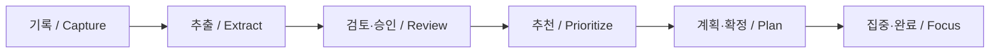
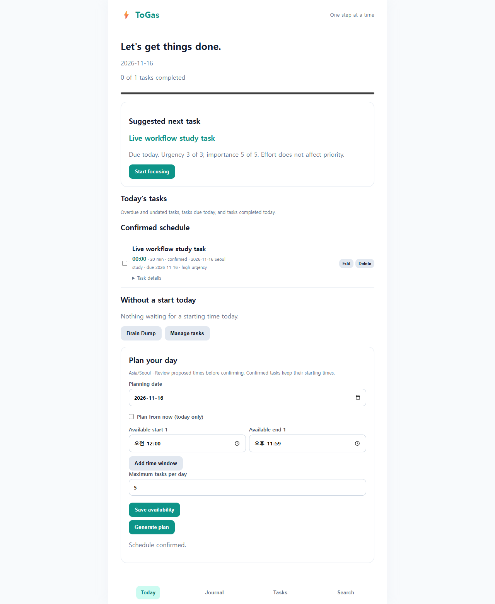
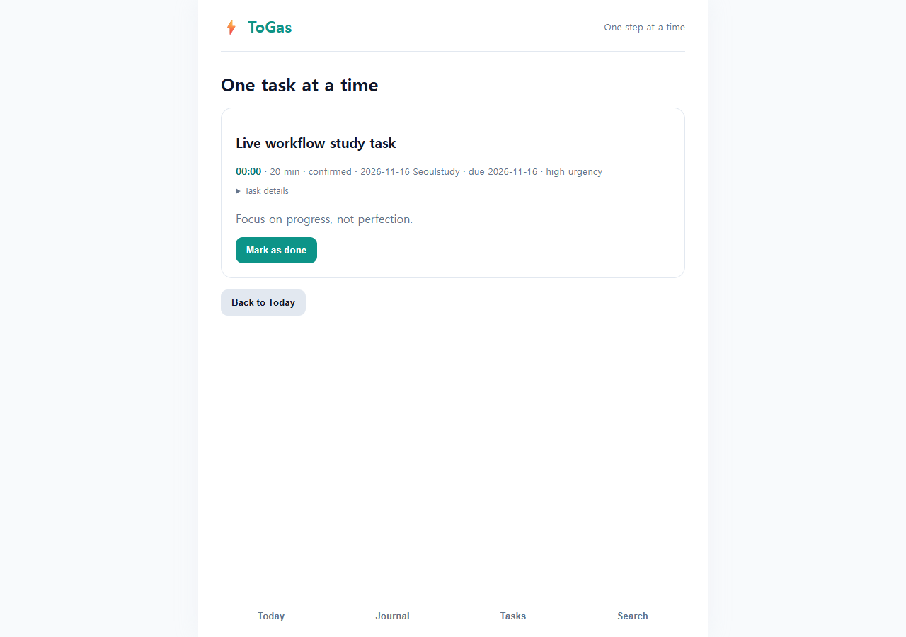

# ToGas — AI-Assisted Planning Manager

**생각을 행동으로 바꾸는 일정 관리 도우미 / Turn everyday thoughts into actionable plans.**

혼자 사용하는 로컬 생산성 앱입니다. **생각 기록 → 제안 검토 → 다음 할 일 추천 → 한 가지 작업에 집중**하는 흐름을 지원합니다.

React/Vite 프런트엔드, FastAPI 백엔드, SQLite 저장소로 구성됩니다. 할 일 문구는 원래 기록을 바탕으로 만들며, 사용자가 승인해야 실제 할 일로 저장됩니다. 시연 순서, 스크린샷, 검증 결과는 [실행·시연 안내](docs/submission/DEMO_GUIDE.md)를 참고하세요.

**English:** ToGas is a local, single-user planner. Write a journal, review task suggestions, plan your day, and focus on one task. Suggestions become tasks only after approval.

## 제출 자료 바로가기 / Start Here for Assessment

**제출 문서는 [`docs/submission/`](docs/submission/)에 있습니다. / Submission documents are in [`docs/submission/`](docs/submission/).**

| 읽는 순서 / Order | 문서 / Document | 내용 / Purpose |
| --- | --- | --- |
| 1 | [제품 개요 / Product Overview](docs/submission/PRODUCT_OVERVIEW.md) | 프로젝트 목적·주요 기능·현재 결과 / Quick introduction to the project and its features |
| 2 | [최종 보고서 / Final Product Report](docs/submission/FINAL_PRODUCT_REPORT.md) | 주요 제출 보고서: 설계·NLP·알고리즘·평가·한계 / Main submission report: design, NLP, algorithms, evaluation and limitations |
| 3 | [실행·시연 안내 / Demo Guide](docs/submission/DEMO_GUIDE.md) | 설치·실행·5분 시연·제출 체크리스트 / Setup, startup, five-minute demo and submission checklist |
| 참고 / Reference | [최신 검증 현황 / Current Status](docs/STATUS.md) | 후속 실험과 날짜별 검증 근거 / Latest experiments and dated verification evidence |

## 폴더 안내 / Folder Guide

```text
ToGas_AI-assist-planning-manager/
├── README.md                  # Start here: introduction, submission links and startup
├── docs/
│   ├── submission/            # Lecturer-facing submission documents (the three files above)
│   ├── screenshots/           # App screenshots used in the documents
│   ├── STATUS.md              # Latest verification status and historical checkpoints
│   └── DAY*.md                # Development reports and readiness notes
├── backend/                   # Python API, NLP adapters, storage and planning logic
│   ├── tests/                 # Backend automated tests
│   └── evaluation/            # Synthetic datasets and saved evaluation results (JSON)
├── frontend/                  # Browser application and frontend package configuration
│   ├── src/                   # React screens, styles, helpers and JavaScript unit tests
│   └── tests/                 # Browser workflow checks
└── .env.example               # Configuration template; contains no private API key
```

로컬 실행 시 `.venv/`, `.venv-clean/`, `node_modules/`, `dist/`, `test-results/`, 캐시, `.env`, SQLite DB가 추가로 보일 수 있습니다. 이들은 실행 환경·생성 결과·개인 설정이며 제출 문서는 아닙니다. 위 트리는 주요 소스와 문서만 표시합니다.

**English:** The tree shows the main source and documentation. Local environments, dependencies, build outputs, test artifacts, caches, private `.env` and SQLite databases are separate from the submission documents. For assessment, begin with `docs/submission/`; use `backend/` and `frontend/` to inspect the implementation.

**현재 상태:** 기본 모드는 오프라인 데모(`mock`)입니다. 공식 TypeSafe Jev 연동은 초기 연결 시험과 2026년 11월 16일 기록 3건 평가를 통과했습니다. 사용 모델은 `jev-1.14.0`이며, 실제 서비스로 전체 브라우저 흐름도 검증했습니다. 데모는 규칙 기반 결과이며 Jev 예측이 아닙니다. 데모에는 키가 필요하지 않습니다. 일반적인 모델 품질은 아직 측정하지 않았습니다.

## 문제와 접근 방식

자유로운 기록에는 감상·완료한 일·미래 의도·기한이 섞입니다. 이를 할 일로 정리하고, 무엇부터 할지 정하고, 가능한 시간에 배치하는 전환을 ToGas가 연결합니다. 대상은 학업·업무·생활 일을 함께 관리하는 개인입니다. AI는 해석을 돕고, 날짜·추천·일정은 앱의 규칙으로 처리하며 저장·확정은 사용자가 결정합니다. 생산성 향상이나 타 제품 대비 우위는 아직 사용자 연구로 검증하지 않았습니다.

**English:** ToGas connects free-form notes, task review and feasible daily planning for individuals. AI assists interpretation; rules handle planning and users approve changes. Productivity benefits have not been measured.

## 제품 흐름



**English:** Capture → extract → review → prioritize → plan → focus and complete. Manual tasks and focusing without a schedule are also supported.

## 구조와 기술

| 구성 | 기술·역할 |
| --- | --- |
| 화면 | React/Vite, Journal·Review·Tasks·Planner·Focus·Search |
| API·검증 | Python 3.12, FastAPI, Pydantic, Uvicorn |
| 저장 | SQLite, 기록·작업·가용 시간·확정 요청 확인 |
| 분석 | 후보 분리 규칙, 기본 mock 또는 선택적 TypeSafe Jev API |
| 계획 | 기한·긴급도·중요도 순위, 가장 이른 빈 구간 배정 |

화면 → FastAPI → SQLite를 기본으로, 분석 시에만 선택한 제공자를 사용합니다. 노력·에너지는 현재 순위를 바꾸지 않습니다. [최종 보고서](docs/submission/FINAL_PRODUCT_REPORT.md)에 구조도·API·알고리즘을 설명했습니다.

**English:** React/Vite calls FastAPI, which validates inputs and coordinates SQLite, analysis and deterministic planning. Effort and energy do not currently change ranking.

## 실제 앱 화면





11월 16일 실제 서비스 브라우저 흐름에서 합성 데이터·임시 SQLite로 촬영했습니다. 첫 그림의 00:00 배정은 하루 전체 계획 결과입니다. 최종 소수 긴급도 표시 수정 전 화면이며, [모바일·완료 화면과 시연 안내](docs/submission/DEMO_GUIDE.md)에 추가 자료가 있습니다.

**English:** Actual application captures from the live-service workflow using synthetic data. The midnight placement used full-day planning. Screenshots predate the final fractional-urgency display fix.

## Windows에서 실행하기

Python 3.12와 Node.js 22 이상이 필요합니다. Node 24에서 검증했습니다. 저장소 루트에서 실행하세요.

```powershell
py -3.12 -m venv .venv
.\.venv\Scripts\python.exe -m pip install -r backend/requirements.txt -c backend/constraints.txt
$env:TOGAS_AI_MODE = 'mock'
.\.venv\Scripts\python.exe -m uvicorn main:app --app-dir backend --reload
```

두 번째 터미널에서 실행합니다.

```powershell
cd frontend
npm.cmd ci
npm.cmd run dev
```

앱: http://127.0.0.1:5173 · API 문서: http://127.0.0.1:8000/docs

Python 실행 파일과 `npm.cmd`를 직접 사용하면 PowerShell의 활성화·스크립트 실행 정책 문제를 피할 수 있습니다. 시스템 보안 정책 변경은 필요하지 않습니다. Vite는 npm 재정의를 통해 [Rollup 공식 WebAssembly 대체 패키지](https://rollupjs.org/migration/#compatibility)를 사용하여 Windows Application Control에서 차단될 수 있는 네이티브 모듈을 대체합니다. 프런트엔드 버전은 잠금 파일에 기록되어 있습니다.

위 설치 명령은 `backend/constraints.txt`로 검증 당시의 Python 의존성을 지정합니다. 기본·테스트 의존성과 선택적인 로컬 모델 패키지는 분리되어 있습니다. 로컬 모델 라이브러리 없이 새 환경을 설치하고 검증했습니다. 초기 설치에는 다운로드가 필요할 수 있으며 준비된 환경의 기본 mock 흐름은 오프라인으로 동작합니다.

**English:** Run the backend and frontend in separate terminals, then open port 5173. The command uses verified dependency constraints and explicitly selects mock mode. Initial setup may need internet; the prepared mock workflow runs offline.

## 주요 기능

화면의 버튼 이름은 영어로 표시됩니다. 실제 화면 이름을 함께 안내합니다.

- **오늘(Today):** 기한 초과·오늘 기한·기한 없는 작업, 오늘 완료한 작업과 진행률을 표시합니다. 다음 할 일과 추천 이유도 확인할 수 있습니다.
- **기록(Journal):** 분석 없이 저장하거나 이전 기록을 열고 제안을 미리 봅니다. **Open entry**는 편집기로 이동해 입력 포커스를 맞춥니다. 같은 기록의 반복 분석은 저장된 항목을 재사용합니다. 저장 후 응답만 유실되어도 재시도 시 중복 저장하지 않습니다. 기록 수정은 새 버전으로 저장하며 기존 이력을 유지합니다.
- **검토(Review):** 추출 개수와 원문을 확인하고 제목·분류·기한·우선순위를 수정한 뒤 승인·거절합니다. 예측 상세 정보는 펼쳐 볼 수 있으며 없는 신뢰도는 `not provided`입니다. 누락된 작업도 직접 추가하고 승인할 수 있습니다. 화면 이동 중 미검토 제안과 실패 입력을 유지하며, 추출 결과가 없어도 기록 저장 여부를 안내합니다.
- **할 일(Tasks):** **All Tasks** 옆 **+**로 추가 양식을 엽니다. 전체·미완료·완료·일정 확정·미배정 필터를 제공합니다. **Task details**에서 우선순위를 확인합니다. 닫아도 초안은 유지하며 저장 성공 시 초기화합니다. 수정·완료·다시 열기·삭제를 지원합니다. 응답 유실 후 수동 저장·승인 재시도는 UUID를 재사용하며 **Reload workspace** 후에도 중복을 방지합니다.
- **검색(Search):** 작업 제목과 기록 내용에서 대소문자 구분 없이 문자열을 검색합니다. 한국어도 검색할 수 있습니다.
- **집중(Focus):** 한 작업에 집중하고 완료한 뒤 Today로 돌아갑니다. 완료 실패 시 작업을 열린 상태로 유지하여 재시도할 수 있습니다.
- **일정 계획(Planning):** **Today → Plan your day**에서 가능한 시간대와 하루 최대 작업 수를 저장합니다. **Generate plan**으로 만든 제안의 시간·미배정 이유를 확인한 뒤 **Confirm plan** 또는 **Reject plan**을 선택합니다. 확정 작업은 시간순으로 표시하며 소요 시간과 임시 추정 여부를 보여 줍니다. **Planning details**에서 중요도(1–5), 예상 시간, 노력 수준(1–5), 선택적인 수동 확정 시작 시간을 설정합니다. 예상 시간이 없으면 null로 유지하며 계획에 임시 30분을 사용한다고 표시합니다. 오래된 제안은 다시 생성해야 합니다. [Day 3 보고서](docs/DAY3_REPORT.md)를 참고하세요.
- **현재 시각부터 계획(Plan from now):** 오늘에만 선택할 수 있으며 서울 현재 시각 이전에 새 작업을 배정하지 않습니다. 기본값은 하루 전체 계획이고 미래 날짜는 전체 가용 시간을 사용합니다. 기존 확정 시간은 유지합니다. 제안 시작 시간이 확정 전에 지나면 다시 생성해야 합니다. **Why this task?**에서 배정 이유를 확인합니다.

**English:** Save journals, review suggestions, manage and search tasks, and focus. Save availability before generating a plan, then confirm it. “Plan from now” skips elapsed time today.

## AI 모드와 Jev 연결

`TOGAS_AI_MODE`의 기본값은 `mock`입니다. 화면에 데모 모드임을 표시하고 모의 신뢰도는 숨깁니다. 제안은 사용자 검토를 거칩니다. 일반 개발·자동 테스트에서는 Jev를 호출하거나 모델을 다운로드하지 않습니다.

환경 설정 예시는 `.env.example`입니다. 백엔드는 루트 `.env`를 읽되 명시적인 셸 환경 변수는 덮어쓰지 않습니다. 키를 채팅·소스·스크린샷·Git에 포함하지 마세요. `.env`는 Git에서 제외됩니다.

어댑터는 TypeSafe의 [공식 요청·응답 규약](https://docs.typesafe.ai/api/system-one)을 따릅니다. `POST https://api.typesafe.ai/v1/systemone`에 Bearer 인증과 `model`, `state`, `questions` 필드를 사용합니다. 키는 서버의 Authorization 헤더에만 넣습니다. 호스트는 고정이며 다른 게이트웨이나 리디렉션은 사용하지 않습니다.

실제 서비스를 사용할 때는 백엔드를 종료하고 루트에서 다시 실행하세요.

```powershell
$env:TOGAS_AI_MODE = "jev"
.\.venv\Scripts\python.exe -m uvicorn main:app --app-dir backend --reload
```

브라우저를 새로 고치면 Journal에 **Live Jev mode**와 **Organize with Jev**가 표시됩니다. `JEV_API_KEY`는 비공개 `.env`에서 읽고 `JEV_MODEL` 기본값은 `jev-latest`입니다. 오프라인으로 돌아가려면 백엔드를 종료하고 `$env:TOGAS_AI_MODE = "mock"`으로 설정한 뒤 재시작하세요. 기록 저장·작업 CRUD·앱 시작·상태 확인·추천에는 Jev를 호출하지 않습니다.

분석 1회는 최대 15개 후보를 HTTP 요청 1회로 묶고 성공한 동일 요청을 제한된 메모리 캐시에서 재사용합니다. 자동 재시도·리디렉션·실패 시 모의 전환은 없습니다. Jev를 사용하면 후보 문장이 외부 API로 전송됩니다. 키나 개인 DB를 제출하지 마세요.

로컬 OpenJevX 로더는 있으나 **실제 가중치 미검증**입니다. `backend/requirements-local-ai.txt`, `TOGAS_AI_MODE=local`과 검토한 파일을 가리키는 `TOGAS_OPENJEVX_DIR`가 필요합니다. Qwen/Ollama는 향후 계획입니다. 상세 규약·평가·제한은 [최종 보고서](docs/submission/FINAL_PRODUCT_REPORT.md)를 참고하세요.

**English:** Mock mode is offline. Use `TOGAS_AI_MODE=jev` and a private key for real analysis. Requests are batched and cached; failures never silently switch to mock. Local OpenJevX remains unverified.

## 테스트와 평가

2026-11-16의 기존 검증 기록입니다. 이번 문서 정리에서 새로 실행한 전체 검사 결과는 아닙니다.

| 평가 | 결과·범위 |
| --- | --- |
| 기능·환경 | 백엔드 108개, JavaScript 11개, 브라우저 25개 시나리오(부모 포함 26개), 새 설치·의존성·빌드 통과 |
| 규칙 기반 mock | 같은 합성 개발 기록 40건에서 F1 0.7273 → 0.9647, 정확한 개수 30/40 → 39/40 |
| 실제 Jev | 선택 기록 3건의 예상 작업 수 1·2·0, 분류 3개·명시적 날짜 2개 일치 |
| 실제 브라우저 | 기록부터 수정·승인·일정 확정·Focus 완료·새로 고침 후 유지 통과 |

모의 결과는 Jev 정확도가 아닙니다. 실제 표본도 작아 일반 품질·신뢰도 보정·생산성 효과를 주장할 수 없습니다. 원자료·토큰·지연·요청 집계는 [최종 보고서의 평가](docs/submission/FINAL_PRODUCT_REPORT.md#13-평가와-결과--evaluation-and-results)와 [검증 현황](docs/STATUS.md)에 있습니다.

루트에서 실행합니다.

```powershell
.\.venv\Scripts\python.exe -m pip install -r backend/requirements-dev.txt
.\.venv\Scripts\python.exe -m unittest discover -s backend/tests -v
.\.venv\Scripts\python.exe backend/evaluate.py --mode mock
.\.venv\Scripts\python.exe backend/evaluate.py --mode mock --dataset backend/evaluation/day4-journals.json --reference-date 2026-11-14
```

`frontend`에서 실행합니다.

```powershell
npm.cmd test
npm.cmd run test:browser
```

브라우저 명령은 먼저 프로덕션 파일을 빌드합니다. Chrome 설치 및 빈 포트 8000/5173이 필요합니다. 임시 서버·SQLite를 사용하므로 기존 앱 데이터는 바꾸지 않습니다. 다른 Python은 `TOGAS_TEST_PYTHON`, 설치된 Edge는 `TOGAS_BROWSER_CHANNEL=msedge`로 지정하세요. 브라우저 다운로드는 필요하지 않습니다. 실패 응답을 가로채는 시나리오와 실제 백엔드의 모의 파이프라인을 검사합니다. 부모 테스트를 포함한 요약은 26개 통과로 표시됩니다.

앱을 켠 채 검사하려면 테스트 터미널에 `TOGAS_TEST_API_PORT=18000`, `TOGAS_TEST_UI_PORT=15173`, `VITE_API_URL=http://127.0.0.1:18000/api`를 설정하세요. 추가 CORS 출처는 임시 백엔드에만 적용합니다. 종료 후 `VITE_API_URL`을 제거하고 `npm.cmd run build`로 기본 API 주소를 복원하세요.

위 검사는 실제 Jev 호출 없이 수행합니다. 생성 스크린샷은 Git에서 제외된 `frontend/test-results/`, 제출용 이미지는 `docs/screenshots/`에 있습니다. 실제 평가 진단은 일반 테스트와 분리되어 있으며 명시적인 선택이 필요합니다. [검증 현황](docs/STATUS.md)에 정확한 절차와 과거 기록을 보존했습니다.

**English:** These commands run offline tests with isolated data and mocked hosted responses. Recorded mock and live results are separate. See the final report for metrics and evidence.

## 로컬 저장과 복구

SQLite는 Git에서 제외된 `backend/togas.db`를 사용합니다. 추가형 마이그레이션은 기존 기록을 보존합니다. 기록·작업 저장 UUID와 확정 요청 확인 정보로 동일 요청의 중복 생성과 이전 수정·완료 상태의 되돌림을 방지합니다. 같은 요청 ID의 다른 내용이나 삭제된 작업 재시도는 충돌로 처리합니다. 중요한 DB는 업그레이드 전에 백업하세요.

**English:** SQLite stores data locally. Additive migrations preserve records and request receipts protect retries. Back up important data before upgrades.

## 향후 개선

오프라인 사용을 우선합니다. Qwen3-8B/Ollama 기반 로컬 AI를 Jev 대체 후보로 평가하고, 한국어 추출·독립 정답 평가, 새로 고침 후 초안 복구·로컬 백업, Windows 실행 간소화, 일정 재배정, 한국어 화면·접근성을 순서대로 개선할 계획입니다. 모두 향후 계획이며 현재 구현된 기능이 아닙니다. 현재 오프라인 분석은 규칙 기반 `mock`입니다. 자세한 구현 방향과 확인 기준은 [제출 안내의 향후 개선 계획](docs/submission/DEMO_GUIDE.md#향후-개선-계획)을 참고하세요.

**English:** Offline use comes first. Planned work includes local AI evaluation, better Korean extraction, draft recovery and backups, simpler Windows startup, rescheduling, and localization/accessibility. Qwen/Ollama is not integrated yet.

## 제한 사항

로컬 데모로 인증·클라우드 동기화·배포 보안은 없습니다. 드문 약어, 모호한 병렬 구조, 다양한 한국어 복합 표현, 공유 목적어·기한은 오해할 수 있습니다. 알려지지 않은 명령형이나 구분자 없는 행동 나열은 놓칠 수 있습니다. 모호한 후보는 원문과 검토 이유를 유지합니다. 분석당 첫 15개 후보만 처리하며 긴 입력은 경고합니다.

잘못된 행동 확률은 안전하게 오류로 처리합니다. 잘못된 분류·긴급도는 설명이 있는 임시값, 없는 신뢰도는 null입니다. 긴 제목은 원문과 비교할 수 있고 반복 의도는 자동 병합하지 않고 표시합니다. 모의 규칙은 불완전하며 Jev 품질을 나타내지 않습니다. 일별 에너지·상황 정보 영구 저장은 보류했습니다.

앱 내 화면 이동은 초안을 유지하지만 전체 브라우저 새로 고침은 미저장 초안과 기록·작업 재시도 ID를 유지하지 않습니다. 분석 전에 기록을 저장하면 모델 실패로부터 내용을 보호합니다. 같은 세션 재시도는 응답 유실 후 중복을 방지합니다. 작업 내용 변경은 새 요청이므로 불확실한 실패 뒤에는 그대로 재시도하거나 Tasks에서 저장 여부를 확인한 뒤 수정하세요. **Reload workspace**는 초안·재시도 상태를 유지하지만 전체 새로 고침은 유지하지 않습니다.

참조된 `Jev_Tutorial(1).ipynb`는 제공된 작업 공간에 없었습니다. XP·타이머·수익화·소셜·분석 기능은 추가하지 않았습니다.

**English:** This is a local demo without authentication or cloud sync. Review ambiguous language and dates manually. Only the first 15 candidates are analyzed. Save journals before analysis; unsaved drafts do not survive a full browser reload.

## 문서 안내

| 문서 | 읽는 목적 |
| --- | --- |
| [제품 개요](docs/submission/PRODUCT_OVERVIEW.md) | 짧은 문제·솔루션·현재 결과 소개 |
| [최종 제품 보고서](docs/submission/FINAL_PRODUCT_REPORT.md) | 학술 제출용 배경·구조·알고리즘·평가·논의 |
| [실행·시연 안내](docs/submission/DEMO_GUIDE.md) | 설치·오프라인 5분 시연·체크리스트 |
| [검증 현황](docs/STATUS.md) | 현재 상태·검증 근거·이전 기록 |
| [Day 3](docs/DAY3_REPORT.md) / [Day 4](docs/DAY4_REPORT.md) | 당시 구현·평가 기록 |

**English:** Start with the product overview, read the final report for detail, and use the submission guide to run the demo.
