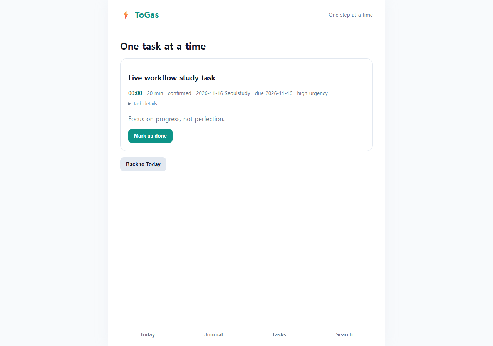

# ToGas submission and demo guide

Verified November 16, 2026 (Asia/Seoul). ToGas turns a journal into reviewable task suggestions, then helps the user choose, schedule and complete one task. It is a local, single-user React/FastAPI/SQLite application.

## Start the demo

Requirements: Python 3.12, Node.js 22+ and two terminals. From the repository root:

```powershell
py -3.12 -m venv .venv
.\.venv\Scripts\python.exe -m pip install -r backend/requirements.txt -c backend/constraints.txt
$env:TOGAS_AI_MODE = 'mock'
.\.venv\Scripts\python.exe -m uvicorn main:app --app-dir backend --reload
```

In the second terminal:

```powershell
cd frontend
npm.cmd ci
npm.cmd run dev
```

Open http://127.0.0.1:5173. Mock mode needs no key and makes no model calls. Existing local tasks/journals remain in `backend/togas.db`; the walkthrough below creates a new journal and task, so use a separate copy of the project if an empty demo workspace is required.

## Five-minute walkthrough

1. Open **Journal** and enter `I need to read my study notes today.` Click **Save journal**, then show the saved entry in history. Saving is independent of AI analysis.
2. Click **Preview suggestions**. Explain that this run uses demo rules. Review displays the source and possible task; it has not saved a task yet.
3. Edit the title to `Read study notes`, choose Study and High urgency, and check today's due date. Under **Planning details**, set importance 5 and estimated minutes 20. Click **Approve**.
4. Open **Today**. Show the suggested next task and its priority explanation. With pre-existing work, the recommendation may be a different task; ranking considers deadlines, urgency and importance.
5. In **Plan your day**, save an availability window that has at least 20 minutes remaining today. Enable **Plan from now** to exclude elapsed time. Click **Generate plan**, inspect **Why this task?**, then **Confirm plan**. Proposal generation does not commit task times.
6. Show the confirmed time in Today's schedule. Click **Start focusing** on the recommended task, then **Mark as done**. Show the completion count and reload to demonstrate persistence.

If today's remaining availability is too short, use full-day planning with **Plan from now** off and explain that it can propose an earlier time. The recorded live workflow used full-day availability and therefore placed its task at 00:00. The from-now behavior was verified separately by offline fixed-clock and browser tests.

## Optional real Jev demonstration

Use only a deliberate shared-service session. Configure `JEV_API_KEY` in the private root `.env` using `.env.example` as a reference. Stop the backend, set `$env:TOGAS_AI_MODE = 'jev'` and restart it with the same uvicorn command. Refresh the browser and confirm **Live Jev mode** before clicking **Organize with Jev**. One analysis batches up to 15 candidates in one request; identical successful analyses may be cached. Failure remains visible without switching to mock results.

Review every suggestion before approval. Unknown or uncertain metadata can be corrected manually; missing tasks can be added in Review. Return to mock mode by stopping the backend, setting `$env:TOGAS_AI_MODE = 'mock'` and restarting. Never include `.env`, keys or the personal application database in the submission.

## Evidence included

| Evidence | Result |
| --- | --- |
| Fresh pinned Python install and `pip check` | Passed; 108 backend tests passed in the fresh environment |
| Clean `npm ci` and JavaScript unit tests | Passed; 11 tests, no audit vulnerabilities reported |
| Production browser suite | 25 scenarios passed (26 tests including the parent); temporary SQLite, offline/mock hosted responses |
| Final production build | Passed with default API address restored |
| [Capped live Jev evaluation](../backend/evaluation/day4-jev-results.json) | 3 synthetic English/Korean/negated journals; expected spans, counts, categories and labeled dates matched |
| [Real-service browser workflow](../backend/evaluation/live-workflow-results.json) | Journal through edited approval, schedule confirmation, recommendation, Focus and persistent completion passed |

Final review also fixed fractional urgency display: a model value such as 1.88 now appears as `Suggested: 1.88 / 3` rather than visually falling back to the first integer option. An intercepted-hosted browser regression verifies the displayed value and preservation on approval. This final display fix was tested offline; no additional live requests were made for submission preparation.

The capped live evaluation used three requests; browser validation used two (one successful analysis followed by an automation selector failure, then a complete passing run). These are in addition to the earlier single smoke request. Current live evidence totals six requests, with no claim of broad accuracy or calibrated confidence.

## Screenshots from the real-service workflow

Captured November 16 using synthetic text and temporary SQLite, before the final fractional-urgency display correction. The selected screenshots show scheduling, Focus and completion rather than that corrected review field.





## Scope and limitations

No authentication, cloud synchronization or deployment hardening is included. Unsaved drafts do not survive a full browser reload. Only the first 15 candidates are analyzed, with a warning for longer entries. Ambiguous coordination, arbitrary Korean morphology, shared deadlines and vague dates need manual review. Scheduling covers one day, protects confirmed times and uses a labeled 30-minute fallback for unknown durations. Persistent daily energy input is deferred.

The 40-journal mock development fixture and three-journal live subset are synthetic and small. Their metrics cannot establish general English/Korean accuracy or calibrate probability thresholds. See [STATUS.md](STATUS.md) and [DAY4_REPORT.md](DAY4_REPORT.md) for detailed evidence and historical checkpoints.

## Reproduce offline checks

From the root:

```powershell
.\.venv\Scripts\python.exe -m pip install -r backend/requirements-dev.txt -c backend/constraints.txt
.\.venv\Scripts\python.exe -m pip check
.\.venv\Scripts\python.exe -m unittest discover -s backend/tests
```

From `frontend`, with ports 8000/5173 free and Chrome installed:

```powershell
npm.cmd ci
npm.cmd test
npm.cmd run test:browser
npm.cmd run build
```

These checks make no live model calls. The opt-in `tests/live-workflow.mjs` diagnostic is separate from the test command and requires explicit environment opt-in; see [STATUS.md](STATUS.md).
