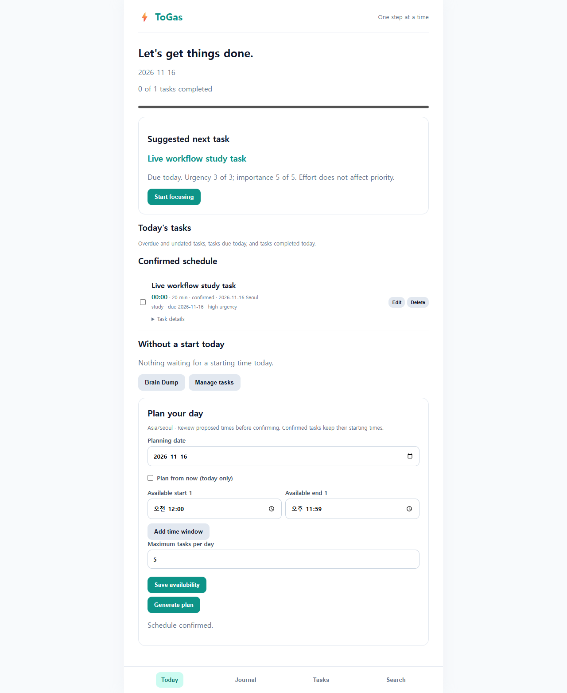
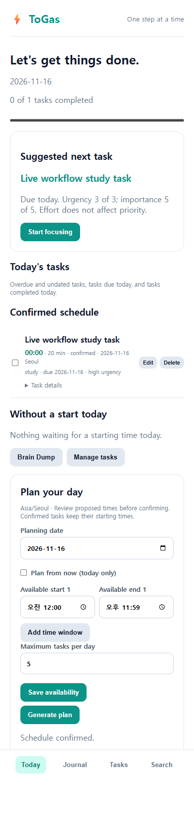
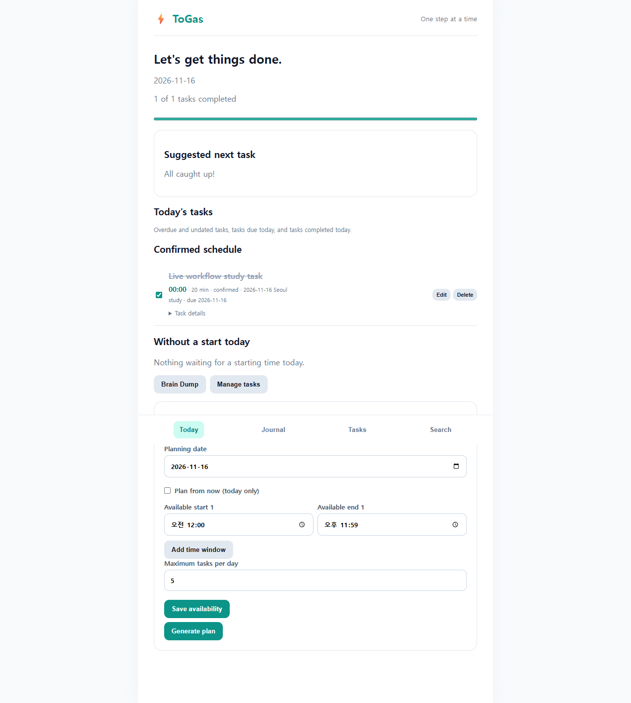

# ToGas 제출 및 시연 안내

2026년 11월 16일(Asia/Seoul) 검증 기준입니다. ToGas는 기록에서 검토 가능한 할 일을 제안하고, 사용자가 작업을 선택·계획·완료하도록 돕는 로컬 단일 사용자 React/FastAPI/SQLite 앱입니다.

**English:** This guide covers setup, a five-minute demo, verification evidence and limitations. ToGas is a local planner that saves tasks only after approval.

## 데모 실행

Python 3.12, Node.js 22 이상, 터미널 2개가 필요합니다. 저장소 루트에서 실행하세요.

```powershell
py -3.12 -m venv .venv
.\.venv\Scripts\python.exe -m pip install -r backend/requirements.txt -c backend/constraints.txt
$env:TOGAS_AI_MODE = 'mock'
.\.venv\Scripts\python.exe -m uvicorn main:app --app-dir backend --reload
```

두 번째 터미널에서 실행합니다.

```powershell
cd frontend
npm.cmd ci
npm.cmd run dev
```

http://127.0.0.1:5173을 여세요. 모의 모드는 키나 모델 호출이 필요하지 않습니다. 기존 작업·기록은 `backend/togas.db`에 남습니다. 아래 시연은 새 기록과 작업을 생성하므로, 빈 시연 공간이 필요하면 프로젝트의 별도 복사본을 사용하세요.

**English:** Run the two terminals above and open port 5173. Mock mode is offline. Use a separate project copy if you need an empty demo database.

## 5분 시연 순서

실제 화면의 영어 버튼 이름을 그대로 표기했습니다.

1. **Journal**에서 `I need to read my study notes today.`를 입력합니다. **Save journal**을 누르고 저장 이력을 보여 주세요. 기록 저장은 AI 분석과 독립적입니다.
2. **Preview suggestions**를 누릅니다. 규칙 기반 데모임을 설명하고 원문과 제안을 보여 주세요. 이 단계에서는 실제 작업이 저장되지 않습니다.
3. 제목을 `Read study notes`로 수정하고 Study 분류와 High 긴급도를 선택합니다. 오늘 기한인지 확인합니다. **Planning details**에서 중요도 5, 예상 시간 20분을 입력한 뒤 **Approve**를 누릅니다.
4. **Today**에서 추천 작업과 이유를 보여 주세요. 기존 작업이 있으면 다른 작업이 추천될 수 있습니다. 추천은 기한·긴급도·중요도를 고려합니다.
5. **Plan your day**에서 오늘 남은 시간이 최소 20분인 가용 시간대를 저장합니다. **Plan from now**를 켜서 지난 시간을 제외합니다. **Generate plan → Why this task? → Confirm plan** 순으로 제안을 검토·확정합니다. 제안 생성만으로 작업 시간은 저장되지 않습니다.
6. Today에서 확정 시간을 보여 주세요. 추천 작업의 **Start focusing**을 누른 뒤 **Mark as done**으로 완료합니다. 완료 수를 보여 주고 새로 고침 후에도 유지됨을 확인합니다.

오늘 남은 시간이 짧으면 **Plan from now**를 끄고 하루 전체 계획을 사용하되, 지난 시각도 제안할 수 있음을 설명하세요. 기록된 실제 서비스 검증은 하루 전체 가용 시간을 사용해 00:00에 배정했습니다. 현재 시각부터 배정하는 기능은 별도의 오프라인 고정 시각·브라우저 테스트로 검증했습니다.

**English:** Save a journal, preview and edit a suggestion, approve it, save availability, confirm a plan, then focus and complete. “Plan from now” avoids past times today.

## 선택 사항: 실제 Jev 시연

공유 서비스 사용을 명시적으로 결정한 세션에서만 실행하세요. `.env.example`을 참고하여 루트의 비공개 `.env`에 `JEV_API_KEY`를 설정합니다. 백엔드를 종료한 뒤 `$env:TOGAS_AI_MODE = 'jev'`로 설정하고 같은 uvicorn 명령으로 재시작하세요. 브라우저를 새로 고쳐 **Live Jev mode**를 확인한 다음 **Organize with Jev**를 누릅니다. 분석은 최대 15개 후보를 요청 1회로 묶으며 동일한 성공 분석은 캐시할 수 있습니다. 실패를 표시하며 모의 결과로 자동 전환하지 않습니다.

모든 제안을 검토한 뒤 승인하세요. 불확실한 정보는 직접 수정하고 누락된 작업은 Review에서 추가할 수 있습니다. 복귀 시 백엔드를 종료하고 `$env:TOGAS_AI_MODE = 'mock'`으로 바꾼 뒤 재시작합니다. `.env`, 키, 개인 앱 데이터베이스는 제출물에 포함하지 마세요.

**English:** Real Jev mode uses your private key and shared API usage. Review suggestions before approval. Restart in mock mode afterward; never submit keys or personal data.

## 포함된 검증 근거

| 검증 항목 | 결과 |
| --- | --- |
| 새 Python 환경의 고정 의존성 설치와 `pip check` | 통과, 새 환경에서 백엔드 108개 테스트 통과 |
| 깨끗한 `npm ci`와 JavaScript 단위 테스트 | 통과, 11개 테스트 및 감사 결과 취약점 0건 |
| 프로덕션 브라우저 검사 | 25개 시나리오 통과(부모 포함 26개), 임시 SQLite와 오프라인·모의 호스팅 응답 사용 |
| 최종 프로덕션 빌드 | 기본 API 주소를 복원한 상태로 통과 |
| [호출 수를 제한한 실제 Jev 평가](../backend/evaluation/day4-jev-results.json) | 영어·한국어·부정 의도 합성 기록 3건, 예상 구간·개수·분류·명시적 날짜 일치 |
| [실제 서비스 브라우저 흐름](../backend/evaluation/live-workflow-results.json) | 기록부터 수정·승인, 일정 확정, 추천, Focus, 새로 고침 후 완료 유지까지 통과 |

최종 검토에서 소수 긴급도 표시도 수정했습니다. 모델의 1.88 같은 값을 첫 정수 선택지로 잘못 보이게 하지 않고 `Suggested: 1.88 / 3`으로 표시합니다. 호스팅 응답을 가로채는 브라우저 회귀 검사로 표시값과 승인 후 저장값을 확인했습니다. 이 수정은 오프라인으로 검사했으며 제출 준비 중 추가 실제 요청은 없었습니다.

제한 평가는 요청 3회, 브라우저 검증은 2회였습니다. 첫 브라우저 분석은 성공했으나 자동화 선택자 오류로 중단했고, 수정 후 전체 재실행이 통과했습니다. 이전 연결 시험 1회를 합쳐 실제 근거는 총 6회 요청입니다. 일반 정확도나 신뢰도 보정 수준을 주장하지 않습니다.

**English:** Clean installs, 108 backend tests, 11 JavaScript tests and 25 browser scenarios passed. Live evidence totals six requests, including the earlier smoke test. The sample is too small to establish general accuracy.

## 실제 서비스 흐름 스크린샷

11월 16일 합성 문장과 임시 SQLite로 촬영했습니다. 최종 소수 긴급도 표시 수정 전 화면이며, 아래 이미지는 수정된 검토 필드가 아닌 일정·집중·완료 상태를 보여 줍니다.








**English:** Screenshots show the real-service schedule, mobile layout, Focus and persistent completion using synthetic data.

## 범위와 제한 사항

인증·클라우드 동기화·배포 보안 강화는 포함하지 않습니다. 전체 브라우저 새로 고침 후 미저장 초안은 사라집니다. 첫 15개 후보만 분석하고 더 긴 입력에는 경고합니다. 모호한 병렬 행동, 다양한 한국어 활용, 공유 기한, 모호한 날짜는 수동 검토가 필요합니다. 계획은 하루 단위이며 확정 시간을 보호합니다. 예상 시간이 없으면 임시 30분이라고 표시합니다. 일별 에너지 입력의 영구 저장은 보류했습니다.

모의 개발 데이터 40건과 실제 평가 3건은 작고 합성된 데이터입니다. 일반적인 영어·한국어 정확도나 확률 임계값 보정의 근거가 될 수 없습니다. 상세 근거와 과거 기록은 [STATUS.md](STATUS.md), [DAY4_REPORT.md](DAY4_REPORT.md)를 참고하세요.

**English:** This local demo has no authentication or cloud sync. Review ambiguous language manually. Small synthetic datasets do not establish general model quality.

## 오프라인 검사 재현

루트에서 실행합니다.

```powershell
.\.venv\Scripts\python.exe -m pip install -r backend/requirements-dev.txt -c backend/constraints.txt
.\.venv\Scripts\python.exe -m pip check
.\.venv\Scripts\python.exe -m unittest discover -s backend/tests
```

Chrome을 설치하고 포트 8000/5173을 비운 뒤 `frontend`에서 실행합니다.

```powershell
npm.cmd ci
npm.cmd test
npm.cmd run test:browser
npm.cmd run build
```

위 검사는 실제 모델을 호출하지 않습니다. `tests/live-workflow.mjs` 진단은 별도이며 명시적인 환경 변수 설정이 필요합니다. [STATUS.md](STATUS.md)를 참고하세요.

**English:** These commands run offline checks. The opt-in live workflow diagnostic is separate and requires explicit environment opt-in.
