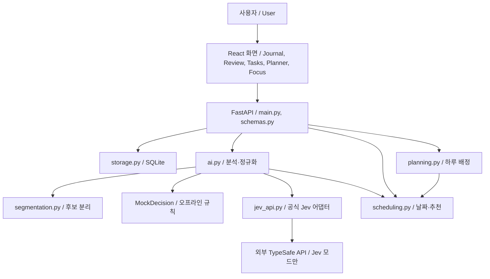
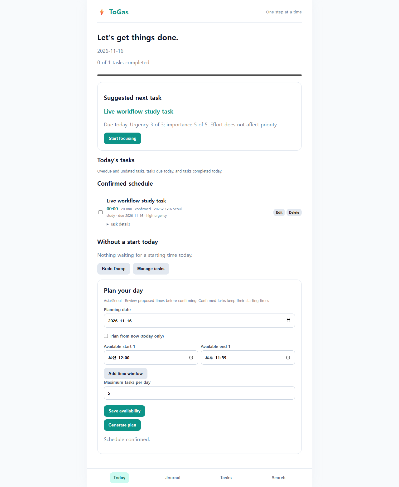
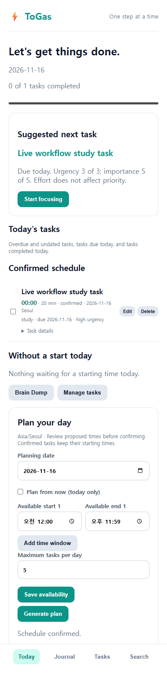
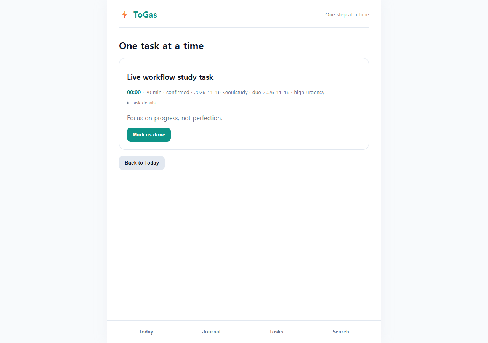
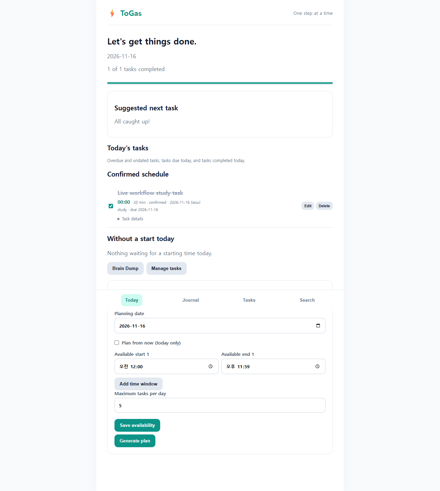

# ToGas — AI-Assisted Planning Manager

**일상의 생각을 구조화된 실행 계획으로 바꾸는 일정 관리 도우미**  
Turning Everyday Thoughts into Structured, Actionable Plans

| 프로젝트 정보 | 내용 |
| --- | --- |
| 유형 | AI 보조 생산성 애플리케이션 / AI-Assisted Productivity Application |
| 주요 기술 | React, Vite, Python, FastAPI, Pydantic, SQLite, TypeSafe Jev API |
| 작성자 | [작성자 이름 / Author] |
| 교과목 | [교과목명 / Course] |
| 소속 | [대학교·학과 / University and Department] |
| 제출일 | [제출일 / Submission Date] |
| 검증 기준일 | 2026-11-16, Asia/Seoul |
| 저장소 | [프로젝트 GitHub](https://github.com/Jeminana/ToGas_AI-assist-planning-manager) |

이 보고서는 현재 소스 코드와 저장된 평가 기록을 바탕으로 작성했습니다. 실행 안내는 [실행·시연 안내](DEMO_GUIDE.md), 짧은 소개는 [제품 개요](PRODUCT_OVERVIEW.md)를 참고하세요. 개인·학사 정보는 제출자가 채워야 합니다.

**English:** This report describes the implemented prototype and recorded evidence as of November 16, 2026. Author and academic information must be completed by the submitter.

## 1. 초록 / Abstract

ToGas는 자유롭게 작성한 기록을 검토 가능한 할 일과 하루 일정으로 연결하는 로컬 단일 사용자 생산성 애플리케이션이다. 기록에는 감상, 완료한 활동, 미래 의도와 기한이 섞일 수 있으며, 이를 실행 계획으로 옮기려면 행동 식별, 우선순위 결정과 시간 배정이 필요하다. 본 프로젝트는 이 과정을 기록, 추출, 사용자 검토, 추천, 일정 확정, 집중과 완료의 흐름으로 구성한다. React/Vite 프런트엔드, FastAPI 백엔드와 SQLite 저장소를 사용하며, Jev는 공식 TypeSafe API를 통해 후보의 행동 여부·분류·긴급도 판단을 지원한다. 후보 분리와 날짜 해석, 우선순위 및 시간 배정은 결정적 규칙으로 처리한다. 제안은 사용자 승인 후에만 작업이 되며 일정도 별도로 확정한다. 기본 오프라인 모드는 규칙 기반 시연이다. 기존 검증 기록은 백엔드 108개, JavaScript 11개, 브라우저 25개 시나리오의 통과와 기록 3건의 제한된 실제 Jev 평가 및 실제 서비스 전체 흐름의 성공을 보고한다. 이 결과는 기능적 통합을 뒷받침하지만 일반적인 모델 정확도나 사용자의 생산성 향상을 입증하지는 않는다. 향후에는 오프라인 로컬 모델 평가, 한국어 추출 강화와 사용성 검증을 우선한다.

**English:** ToGas is a local, single-user productivity application that connects free-form journal writing with reviewable tasks and daily schedules. A journal can mix feelings, completed activities, future intentions and deadlines. Converting this material into action requires identifying tasks, deciding priorities and finding available time. The prototype joins these steps in a workflow of capture, extraction, human review, recommendation, planning, focus and completion. Its interface uses React and Vite, its backend uses FastAPI, and SQLite stores data locally. Through the official TypeSafe API, Jev assists with actionability, category and urgency decisions. Application rules handle candidate segmentation, date interpretation, priority ranking and time placement. Suggestions become tasks only after approval, and schedules require separate confirmation. The default offline demonstration uses rules rather than learned-model inference. Recorded verification reports 108 backend tests, 11 JavaScript tests and 25 browser scenarios passing, alongside a three-journal live Jev evaluation and a complete real-service workflow. These results support functional integration but do not establish broad model accuracy or improved human productivity. Future work prioritizes offline local-model evaluation, stronger Korean extraction and usability studies.

## 2. 서론과 배경 / Introduction and Background

일상적인 책임은 처음부터 정돈된 작업 목록으로 표현되지 않을 수 있다. 기록에는 해야 할 일, 감상, 이미 끝난 활동, 미래 의도, 약속·기한과 한 문장에 포함된 여러 행동이 섞인다. 예를 들어 “내일 과제를 제출하고 친구를 만나야 해”에서는 행동을 나누는 것뿐 아니라 ‘내일’이 어느 행동에 적용되는지도 확인해야 한다.

기록 중심의 흐름에서는 실행 항목을 다시 골라야 하고, 작업 목록 중심의 흐름에서는 자연어 메모를 제목·기한·분류로 옮겨야 한다. 달력에 배치하려면 여기에 가능한 시간과 예상 소요 시간도 필요하다. 이는 서로 다른 작업 흐름의 역할을 설명한 것이며, 특정 기존 제품의 기능 부족이나 ToGas의 비교 우위를 검증한 결과는 아니다.

ToGas는 이 전환 과정을 한 앱 안에서 검토할 수 있도록 연결한다. 준비 부담이 줄어들 수 있다는 설계 가정에서 출발했으며, 사용자 인터뷰·설문·비교 사용성 연구는 아직 수행하지 않았다.

**English:** Notes can mix intentions, reflections, completed actions and deadlines. Moving from notes to tasks and then to a calendar requires interpretation and planning. ToGas connects these steps; comparative superiority and reduced user effort have not been demonstrated.

## 3. 문제 정의 / Problem Statement

| 문제 | 구체적인 어려움 | ToGas의 대응 |
| --- | --- | --- |
| 비구조화된 작업 입력 | 자연어 기록에서 앞으로 할 행동을 감상·완료·부정과 구분해야 한다. | 원문을 보존한 후보 추출과 수정·거절·누락 작업 추가를 제공한다. |
| 우선순위 결정 | 여러 기한, 긴급도와 개인 중요도를 함께 고려해야 한다. | 정해진 정렬 규칙으로 다음 작업과 이유를 제시한다. |
| 목록과 현실적인 일정의 간격 | 작업 목록만으로는 가용 시간과 작업 길이를 만족하는 하루 계획이 만들어지지 않는다. | 가용 구간·예상 시간·하루 한도·확정 예약을 고려해 배정을 제안한다. |

따라서 핵심 문제는 **표현한 의도를 사용자가 확인할 수 있는 작업과 실행 가능한 하루 계획으로 바꾸는 것**이다. 추출·추천·계획을 연결하되 각 단계의 최종 판단은 사용자에게 남긴다.

**English:** The three problems are unstructured capture, competing priorities and the gap between a task list and a feasible schedule. ToGas addresses them together while retaining user approval.

## 4. 프로젝트 목표 / Project Objectives

| 목표 | 구현 연결 및 현재 범위 |
| --- | --- |
| 기록을 검토 가능한 작업 후보로 변환 | `segmentation.py`와 `ai.py`가 원문·행동 구간·검토 이유를 생성한다. |
| 잘못된 행동 추출 줄이기 | 부정·완료·감상 규칙과 행동 여부 판단을 사용한다. 오탐 제거를 보장하지 않는다. |
| 영어·한국어 입력 지원 | 명시적 의도와 제한적 복합 행동을 처리한다. 임의의 한국어 활용은 미지원일 수 있다. |
| 저장 전 사용자 확인 | Review에서 수정·승인·거절하며 수동 작업도 추가한다. |
| 설명 가능한 추천 | `rank_tasks()`와 `priority_explanation()`이 순위와 이유를 제공한다. |
| 가용 시간 기반 하루 계획 | `propose_plan()`과 명시적 확정 API를 사용한다. |
| 한 가지 작업 실행·완료 | Focus와 Today 완료 집계를 제공한다. 타이머는 없다. |
| 로컬 데이터 신뢰성 | SQLite, 추가형 마이그레이션과 요청 확인 정보로 저장·재시도를 보호한다. |
| 공식 Jev 연동 | `jev_api.py`에서 공식 엔드포인트·Bearer 인증·일괄 질문을 사용한다. |

**English:** Objectives map to existing extraction, review, recommendation, scheduling, Focus, persistence and official Jev integration. Language coverage and model quality remain limited.

## 5. 제안 솔루션 / Proposed Solution

기록은 분석 없이도 저장한다. 분석하면 작업 후보를 보여 주고 사용자가 승인한 항목만 작업 목록에 넣는다. 미완료 작업에서 다음 작업을 추천하고, 저장된 가용 시간으로 하루 배정을 제안한다. 사용자는 일정 확정 후 Focus에서 한 작업을 수행하고 완료를 기록한다.


이는 대표 시연 경로다. 사용자는 수동 작업 생성, 일정 없이 집중하기, 제안 거절도 선택할 수 있다. AI 해석, 결정적 계획, 사용자 승인을 분리하므로 완전 자율 비서로 동작하지 않는다.

**English:** Capture → extraction → review → prioritization → planning → focus → completion is the main demonstration path. Users may also create tasks manually or focus without scheduling. ToGas is an assisted workflow with explicit user control.

## 6. 대상 사용자와 활용 사례 / Target Users and Use Cases

주요 대상은 학업·업무·개인 책임을 함께 관리하거나 개인 기록에서 실행 항목을 찾으려는 개인이다. 다음은 현재 기능으로 시연 가능한 가상 사례이며 사용자 연구 결과가 아니다.

| 사례 | 입력·상황 | 지원 흐름 |
| --- | --- | --- |
| 대학생의 학습 계획 | `I need to read my study notes today.` | 기록 저장 → study 제안 검토 → 중요도·20분 입력 → 가용 시간 배정 → 집중·완료 |
| 한국어 복합 기록 | `내일 과제를 제출하고 친구를 만나야 해.` | 두 후보 확인 → 공유 기한 경고 검토 → 각 기한 수정·승인 → 필요한 날짜의 계획 생성 |
| 업무·생활 작업 병행 | 보고서와 장보기 작업을 직접 추가하고 시간대 두 개 저장 | 중요도·긴급도 편집 → 다음 작업 이유 확인 → 배정·미배정 이유 검토 → 일정 확정 |

**English:** Illustrative users include students, journal writers and individuals balancing work and personal commitments. These scenarios use implemented features and are not evidence from a user study.

## 7. 기능 요구사항과 구현 / Functional Requirements and Features

아래 기능은 구현되어 있으며 자동 검증·제한된 실제 서비스 검증의 구분은 13절에 제시한다.

| 기능·목적 | 사용자 조작 | 구현 접근 | 기대 출력·현재 상태 |
| --- | --- | --- | --- |
| 기록 입력·이력 | Journal 저장, Open entry | 독립 저장 API, 기존 기록 재사용·수정 시 새 기록 | 저장 이력·편집기 이동, 구현 |
| AI 보조 추출 | 모드별 분석 버튼 | `ai.py`, mock 또는 공식 Jev 어댑터 | 작업 후보·모델 정보·경고, 구현·소수 실제 평가 |
| 작업 분리 | 자연어·목록 입력 | 문장·안전한 행동절 규칙 | 원문 연결 후보, 제한적 한·영 지원 |
| 사용자 검토 | 수정, Approve, Reject, 누락 추가 | Review와 작업 생성 API | 승인한 작업만 저장, 구현 |
| 수동 작업 관리 | Tasks의 +, 편집·삭제 | 입력 검증·CRUD·요청 UUID | 제목·분류·기한·계획 정보, 구현 |
| 우선순위 추천 | Today와 추천 이유 확인 | 미완료 작업의 결정적 정렬 | 다음 작업·이유, 구현 |
| 하루 일정 계획 | 시간대 저장, Generate/Confirm/Reject | 우선순위 순 가장 이른 빈 구간 배정 | 확정 일정·미배정 이유, 구현 |
| Today 대시보드 | 오늘 작업·일정 조회 | 서울 기준 날짜·완료 집계 | 진행률·시간순 일정·충돌 안내, 구현 |
| Focus | Start focusing | 단일 작업 화면 | 제목·정보·완료 버튼, 구현 |
| 완료 추적 | 완료·다시 열기 | 완료 시각 저장·중복 완료 보호 | 오늘 완료 수·새로 고침 후 유지, 구현 |
| 검색·필터 | 키워드와 작업 상태 선택 | 대소문자 무시 문자열 검색·프런트 필터 | 작업 제목·기록 검색, 구현 |
| 로컬 영구 저장 | 저장·재실행 | SQLite·추가형 마이그레이션 | 기록·작업·가용 시간·확정 보존, 구현 |

전체 새로 고침 후 미저장 초안은 복구하지 않는다. 검색은 의미 검색이 아니며 작업 목록의 기본 정렬은 완료 여부·긴급도·최신 ID 순이다. 추천·계획의 우선순위 정렬과 구분해야 한다.

**English:** Implemented features cover journals, extraction, segmentation, review, task management, recommendations, planning, Today, Focus, completion, literal search and local storage. Unsaved drafts do not survive a full reload. Task-list ordering differs from recommendation ranking.

## 8. 시스템 구조 / System Architecture



화살표는 화면 요청·모듈 호출 관계다. Vite는 개발 서버와 프로덕션 파일 빌드를 담당한다. UI의 Focus는 `main.jsx` 내부 화면이며 독립 `Focus.jsx` 파일이 아니다. 선택적 OpenJevX 로더는 `ai.py`에 있으나 실제 가중치 검증이 없어 위 기본·Jev 경로와 별도로 취급한다.

주요 데이터는 `journals`, `tasks`, `availability_preferences`에 저장한다. 작업은 원본 기록 ID, 기한, 긴급도, 중요도, 예상 시간, 노력, 완료 시각과 확정 배정을 가진다. `task_create_requests`와 `schedule_confirmations`는 응답 유실 재시도의 중복 처리와 이전 수정·완료 상태 보호에 사용한다. 일정 시각은 서울 현지 시각, 생성·완료 시각은 UTC 오프셋을 포함해 기록한다.

| API 그룹 | 실제 엔드포인트 | 역할 |
| --- | --- | --- |
| 상태·오늘 | `GET /api/health`, `GET /api/dashboard` | 모드 확인·오늘 집계 |
| 기록 | `GET/POST /api/journals` | 이력·독립 저장 |
| 작업 | `GET/POST /api/tasks`, `PATCH/DELETE /api/tasks/{task_id}` | 생성·조회·수정·삭제·완료 |
| 분석·추천 | `POST /api/ai/analyze` (`/api/ai/extract` 별칭), `POST /api/ai/prioritize` | 분석 제안·규칙 추천 |
| 검색 | `GET /api/search` | 제목·기록 문자열 검색 |
| 계획 | `GET/PUT /api/availability`, `POST /api/planning/propose`, `POST /api/planning/confirm` | 시간대·배정 제안·확정 |

코드 근거: [main.py](../../backend/main.py), [schemas.py](../../backend/schemas.py), [storage.py](../../backend/storage.py), [프런트 화면](../../frontend/src/main.jsx), [의존성](../../frontend/package.json).

**English:** React screens call FastAPI, which validates inputs and coordinates SQLite, extraction, ranking and planning. Hosted inference is used only in Jev mode. Request receipts protect retries; proposed schedules require explicit confirmation.

## 9. AI·자연어 처리 / AI and NLP Integration

분석 입력은 공백만인 기록을 거절하고 최대 10,000자를 허용한다. 목록·문장·일부 행동절을 분리하면서 원문을 유지한다. 영어 약어·소수·인용문과 공유 목적어를 보수적으로 다루며, 한국어는 알려진 연결형과 의무 표현을 중심으로 처리한다. 일반 형태소 분석기나 자유로운 한국어 문법 해석을 구현한 것은 아니다.

Jev에는 최대 15개 후보를 한 요청으로 보내며 후보별로 `actionable`(noul), `category`(choice), `urgency`(score)를 질문한다. 분류는 study/work/personal/health/other이고 긴급도는 0–3이다. 기본 모델 설정은 `jev-latest`, 저장된 실제 평가의 반환 모델은 `jev-1.14.0`이다. 요청은 `model`, `state`, `questions`로 구성한다. 서버의 Bearer 헤더로 인증하고 자동 재시도·리디렉션은 하지 않는다. 성공한 동일 요청은 제한된 메모리 캐시를 재사용한다. 이는 [TypeSafe 공식 규약](https://docs.typesafe.ai/api/system-one)에 맞춘 구현이다.

행동 확률 0.5 미만은 제외하고, 0.8 미만은 불확실성을 표시한다. 잘못된 행동 확률은 오류로 처리하고, 잘못된 분류·긴급도는 이유가 있는 임시값으로 표시한다. 없는 신뢰도는 `null`/`not provided`이며 모의 신뢰도는 숨긴다. 임계값과 신뢰도는 실제 사용자 자료로 보정하지 않았다. 검토 표시 여부와 관계없이 작업 저장은 사용자 승인 이후다.

기한은 모델 생성값 대신 `scheduling.py`에서 해석한다. ISO 날짜, today/tomorrow/day after tomorrow, 오늘/내일/모레, 일부 요일·다음 주 표현을 지원한다. 공유 기한을 다른 후보에 임의 복사하지 않으며 `tonight`, `this weekend` 같은 모호한 날짜는 수동 검토한다. 제목은 후보 구간을 사용하고 250자를 넘으면 잘라 검토를 요청한다.

| 모드 | 장점·용도 | 한계 |
| --- | --- | --- |
| `mock` 기본 | 준비된 환경에서 키·외부 추론 없이 시연·개발·자동 검사 | 규칙 기반이며 Jev 예측·일반 모델 정확도가 아님 |
| `jev` 선택 | 공식 호스팅 모델의 실제 판단·모델명·사용량 확인 | 인터넷·키·서비스 사용 필요, 제한된 실제 평가 |
| `local` 선택 경로 | 검토한 OpenJevX 파일을 로컬에서 읽는 로더 존재 | 실제 가중치 실행·품질 미검증, 자동 다운로드 없음 |

오프라인 우선은 현재 제품 방향이며 학습된 로컬 AI가 이미 통합되었다는 뜻은 아니다. Qwen/Ollama는 향후 평가 후보다. 분석 실패는 보존된 기록·작업을 바꾸지 않으며 자동으로 다른 제공자에 전송하지 않는다.

코드 근거: [후보 분리](../../backend/segmentation.py), [분석·정규화](../../backend/ai.py), [Jev 어댑터](../../backend/jev_api.py), [날짜 규칙](../../backend/scheduling.py).

**English:** Rules segment candidates and resolve dates. Jev classifies actionability, category and urgency in one batch of up to 15 candidates. Missing confidence stays unavailable, thresholds are uncalibrated, and approval is always required. Mock is offline rules; local learned-model execution is not verified.

## 10. 우선순위와 일정 배정 / Priority Ranking and Scheduling

`rank_tasks()`는 완료 작업을 제외하고 다음 튜플을 오름차순 정렬한다.

```text
(기한 그룹, -긴급도, -중요도, 기한 또는 최댓값, 작업 ID)
기한 그룹: 초과=0, 오늘=1, 내일=2, 그 밖의 미래·기한 없음=3
```

따라서 기한 그룹이 먼저 적용되고 같은 그룹에서는 긴급도·중요도가 높은 작업이 앞선다. 이후 기한과 ID로 동률을 결정한다. 기한 없는 작업과 먼 미래 기한 작업은 같은 그룹이다. 노력과 예상 시간은 순위를 바꾸지 않으며 학습 기반 가중치·개인화는 없다.

일정은 우선순위 순으로 가장 이른 연속 빈 구간에 넣는 탐욕 방식이다. 최적해나 전체 작업 수 최대화를 보장하지 않는다.

```text
저장된 날짜별 가용 구간을 시간순 정렬한다.
오늘의 Plan from now가 켜졌으면 현재 서울 시각을 분 단위로 올려 구간을 자른다.
기존 확정 예약을 점유 구간으로 유지한다.
미완료 작업을 우선순위 순으로 확인한다.
  이미 확정됨 / 선택일보다 이른 기한 / 하루 한도 초과이면 이유를 기록한다.
  그 외에는 예상 시간(미입력 시 임시 30분)이 들어가는 가장 이른 빈 구간을 찾는다.
  배정하면 점유 구간에 추가하고, 맞는 구간이 없으면 미배정 이유를 남긴다.
배정·미배정·기존 충돌을 반환하고, 사용자 확정 전에는 작업 시간을 저장하지 않는다.
```

가용 시간은 같은 날짜의 비중첩 구간 최대 12개, 하루 한도는 1–50개다. 선택일의 기존 확정 작업은 완료된 것도 한도에 포함하며 예약을 자동 이동하지 않는다. 예상 시간이 없으면 `estimated_minutes`는 null로 두고 예약 길이에 임시 30분임을 표시한다. 큰 작업이 들어가지 않아도 뒤의 작은 작업은 확인한다.

미배정 사유는 이미 확정됨, 기한 경과, 하루 한도, 맞는 구간 없음, 남은 시간 부족 등이다. 확정 API는 작업·가용 시간 상태와 서버 서명을 검사해 변경·만료 제안을 409로 거절하고 원자적으로 저장한다. 현재 시각부터 만든 제안은 첫 확정 전에 시작이 지나면 다시 생성해야 한다. 이미 확정된 동일 요청의 재시도는 저장된 확인 결과를 반환한다. 미래 날짜에는 전체 가용 시간을 사용하며 하루 전체 계획이 기본이다.

코드 근거: [순위·설명](../../backend/scheduling.py), [배정](../../backend/planning.py), [확정 처리](../../backend/main.py).

**English:** Ranking uses deadline group, urgency, importance, date and ID. Scheduling greedily finds the earliest continuous gap, preserves confirmed reservations and applies daily limits. Unknown durations use a labeled 30-minute fallback. Plans require confirmation and stale proposals are rejected.

## 11. 화면과 사용자 경험 / Interface and User Experience

Today, Journal, Tasks, Search를 기본 탐색으로 두고 Review와 Focus는 작업 중 진입한다. 기록 작성과 작업 목록을 분리하고 제목·시작 시각을 강조한다. 상세 메타데이터·원문·모델 정보는 펼쳐 확인하며, 실패 입력과 검토 후보는 앱 내 화면 이동 중 유지한다. Focus는 한 작업과 완료 버튼을 중심으로 구성한다. 현재 화면 버튼은 영어이며 아래 그림은 실제 앱에서 합성 데이터로 촬영한 화면이다.



그림 1. 실제 Jev 브라우저 검증의 Today 화면. 하루 전체 계획으로 00:00에 배정한 결과이며 현재 시각부터 계획의 증거는 아니다.



그림 2. 동일 흐름의 모바일 배치. 자동 반응형 검사에는 320·390·1280 너비가 포함되며 실제 서비스 세션은 390·1280에서 넘침을 확인했다.



그림 3. Focus에서 한 작업의 제목과 완료 동작을 제공한다. 타이머·주의력 개선 효과는 주장하지 않는다.



그림 4. 완료 상태가 새로 고침 후에도 유지된 결과. 네 이미지는 11월 16일 임시 SQLite로 촬영했으며 최종 소수 긴급도 표시 수정 전이다. 해당 Review 필드의 수정 검증은 오프라인 회귀 검사로 분리했다.

**English:** The UI separates capture, review and task management, emphasizes titles and times, and offers a simple Focus screen. These are preserved application screenshots from the live-service workflow using synthetic data. They predate the final fractional-urgency display fix.

## 12. 구현·개발 과정 / Implementation and Development Process

| 단계 | 확인된 개발 내용 | 근거 |
| --- | --- | --- |
| 초기 MVP | 기록·Jev·검토·작업·Focus의 기본 흐름 | 초기 가져오기 커밋 `31062ce`; 세부 Day 1 작업 순서는 독립 검증 불가 |
| Day 2·2.5 | 기록 독립 저장·이력·재시도, 검토·후보 분리 안정화 | [STATUS](../STATUS.md), [Day 3 준비](../DAY3_READINESS.md) |
| Day 3 | 중요도·시간·가용 시간, 결정적 추천·배정, 명시적 확정 | `7b72baf`, [Day 3 보고서](../DAY3_REPORT.md) |
| Day 4 | 한·영 추출 규칙·평가 확장, 검토·필터·현재 시각부터 계획 | [Day 4 보고서](../DAY4_REPORT.md) |
| 최종화 | 제한 실제 평가, 실제 브라우저 흐름, 새 설치·제출 자료 | `8326e61`, [검증 현황](../STATUS.md) |

소스 기록과 기존 문서를 근거로 단계를 요약했다. 초기 파일은 Git 이전 작업도 포함하므로 모든 단계가 별도 커밋인 것은 아니다. 핵심 결정은 AI 판단과 계획 규칙의 분리, 저장 전 승인, 기존 데이터를 보존하는 추가형 마이그레이션과 재시도 보호다. 본 제출 문서 정리는 주요 기능·의존성·DB 스키마를 추가하지 않는다.

**English:** Development progressed from a core workflow to reliable review, deterministic scheduling, NLP/UX refinement and final integration checks. Historical reports are preserved; the initial import does not prove a separate commit for every early phase.

## 13. 평가와 결과 / Evaluation and Results

### 13.1 기능 검증 / Functional Evaluation

아래 수치는 기존 [검증 현황](../STATUS.md)과 [Day 4 보고서](../DAY4_REPORT.md)에 기록된 결과다. 이번 문서 작성에서 전체 앱 검사를 새로 실행한 결과와 혼동하지 않아야 한다.

| 검사 | 기록된 결과 | 확인 범위 |
| --- | --- | --- |
| Python 백엔드 | 108개 통과 | API·검증·저장·마이그레이션·재시도·충돌·고정 시각 |
| JavaScript 단위 | 11개 통과 | 작업 저장 ID·계획 정보·서울 날짜 경계 |
| 프로덕션 브라우저 | 시나리오 25개, 부모 포함 테스트 26개 통과 | 임시 SQLite·실제 화면, 호스팅 응답은 모의 전송 |
| 환경·빌드 | 새 Python 설치·pip check·npm ci·프로덕션 빌드 통과 | 잠금·제약 의존성, 당시 npm 감사 취약점 0건 |
| 반응형·복구 | 320·390·1280 너비 및 실패 흐름 확인 | 저장·승인·완료 실패 입력 유지, 응답 유실 재시도 |

이는 해당 시점·환경의 결과이며 현재 의존성 보안 상태나 모든 PC의 성능을 보장하지 않는다. 재현 명령은 [실행·시연 안내](DEMO_GUIDE.md)에 있다.

### 13.2 모의 NLP 평가 / Mock NLP Evaluation

[40건 정답 데이터](../../backend/evaluation/day4-journals.json)의 예상 행동은 43개, 분류 정답은 42개, 명시적 날짜 정답은 14개다. 아래는 **동일한 합성 개발 세트에서 규칙 기반 mock을 비교한 결과**다. 학습된 모델 평가나 독립 시험 결과가 아니다.

| 지표 | Day 3 기준 모의 결과 | Day 4 모의 결과 |
| --- | --- | --- |
| 정밀도 | 82.35% (28/34) | 97.62% (41/42) |
| 재현율 | 65.12% (28/43) | 95.35% (41/43) |
| F1 | 0.7273 | 0.9647 |
| 정확한 작업 개수 | 30/40 | 39/40 |
| 분류 정답 | 22/42 | 37/42 |
| 명시적 날짜 정답 | 9/14 | 14/14 |
| 감상·완료 전용 5건의 오탐 | 0개 | 0개 |
| 후보 분리 단계 예상 구간 누락 | 14개 | 2개 |
| 후보가 있으나 행동 분류에서 누락 | 1개 | 0개 |

행동 구간을 대소문자·공백·경계 문장부호 정규화 후 일대일 대응한다. 분류·날짜 분모에는 추출하지 못한 정답도 포함한다. 구분자 없는 `meet friend cook dinner`는 여전히 후보 하나로 남아 엄격한 채점에서 추가 1개·누락 2개를 만든다. 개발 자료로 규칙을 개선했으므로 일반화 성능을 추론할 수 없다.

원자료: [Day 3 기준 결과](../../backend/evaluation/day4-baseline-mock-results.json), [Day 4 결과](../../backend/evaluation/day4-mock-results.json), [평가기](../../backend/evaluate.py).

### 13.3 실제 Jev 평가 / Real Jev Evaluation

2026-11-16에 `jev-1.14.0`으로 캐시 없는 요청 3회를 실행했다. 재현 기준일은 2026-11-14이므로 tomorrow는 11월 15일이다.

| 기록·종류 | 예상 → 관찰 작업 수 | 관찰 내용 | 입력/출력 토큰 | 전체 분석 지연 |
| --- | --- | --- | --- | --- |
| d4-07, 영어 감상·의도 혼합 | 1 → 1 | study·11월 15일 | 584 / 92 | 512.811 ms |
| d4-10, 한국어 복합 행동 | 2 → 2 | study·personal, 첫 행동만 11월 15일 | 884 / 180 | 196.285 ms |
| d4-12, 영어 부정 의도 | 0 → 0 | 제안 없음 | 585 / 92 | 186.150 ms |

선택한 부분집합에서 행동 구간·분류 3개, 명시적 날짜 2개가 일치하고 서비스 오류는 없었다. 총 입력 2,053·출력 364토큰이다. 지연은 네트워크만이 아닌 로컬 전후 처리를 포함한다. 한국어 두 번째 행동의 기한은 null이며 공유 기한 검토 이유를 남겼다. 날짜 일치는 앱의 날짜 규칙을 포함한 결과이므로 Jev의 날짜 생성 정확도로 해석하지 않는다.

세 기록만으로 일반 정확도·한국어 범용성·신뢰도 보정을 주장할 수 없다. 감상 전용·완료 전용 입력은 이 실제 부분집합에서 평가하지 않았다. 원자료: [실제 제한 평가](../../backend/evaluation/day4-jev-results.json).

### 13.4 실제 전체 흐름 / End-to-End Evaluation

[실제 서비스 브라우저 결과](../../backend/evaluation/live-workflow-results.json)는 기록 독립 저장 → 실제 분석 → 편집·승인 → 원본 기록 연결 → 가용 시간·배정 제안·확정 → Today → Focus 완료 → 새로 고침 후 유지를 통과했다. 성공 실행의 분석은 입력 585·출력 92토큰, 353.412ms다. 승인 전 작업이 없었고 브라우저 오류 목록은 비어 있다.

브라우저 세션 전체는 요청 2회다. 첫 분석은 성공했지만 자동화 선택자 오류로 중단되어 수정 후 전체 실행을 다시 수행했다. 합산 입력 1,170·출력 184토큰이며 서비스 자동 재시도는 아니었다. 앞선 [연결 시험](../../backend/evaluation/jev-smoke.json) 1회와 제한 평가 3회를 더하면 기록된 실제 요청은 총 6회다. 이 요청 수를 독립 정확도 표본 6건으로 보지 않는다.

**English:** Recorded checks include 108 backend tests, 11 JavaScript tests and 25 browser scenarios. Rule-based mock F1 rose from 0.7273 to 0.9647 on the same 40-journal development set. Separately, three live Jev journals matched the expected 1/2/0 tasks, three categories and two dates. A live browser workflow also passed. Six total recorded requests include a smoke test and a repeated browser run; they do not establish general accuracy or calibrated confidence.

## 14. 논의 / Discussion

현재 근거는 기록·모델 판단·검토·저장·일정·완료가 하나의 흐름으로 연결되고, 주요 오류·재시도 경로가 검사되었음을 보여 준다. AI가 문장을 해석하고 앱이 일정 제약을 처리하도록 분리하여 모델 교체 시에도 계획 규칙을 독립 검토할 수 있다. 승인과 원문 표시로 사용자가 잘못된 추출을 수정할 기회를 제공한다.

반면 모의 규칙은 개선에 사용한 자료에서 평가했고 실제 모델 표본은 작다. 낯선 실제 기록은 생략·중의성·개인적 표현을 포함할 수 있으며 후보 분리에서 놓치면 Jev도 해당 행동을 따로 판단하지 못한다. 기능 통합 성공과 언어 일반화, 인간 생산성 효과는 별도의 질문이다. 후자는 독립 자료와 사용자 연구가 필요하다.

**English:** Evidence supports functional integration and tested recovery paths. Separating interpretation from planning makes behavior easier to inspect. Unfamiliar journals, general model quality and human productivity effects remain uncertain and require independent evaluation.

## 15. 제한 사항 / Limitations

| 구분 | 현재 제한 |
| --- | --- |
| 자연어 | 임의의 한국어 활용·생략·구분자 없는 행동 목록·공유 목적어·기한을 완전히 처리하지 못한다. |
| 날짜·분류 | 일부 날짜 표현만 지원하고 모호한 날짜·분류는 검토가 필요하다. |
| 분석·평가 | 처음 15개 후보만 분석한다. 실제 평가는 3건이며 확률 임계값·신뢰도는 보정하지 않았다. |
| 일정 | 하루 단위·연속 구간 탐욕 배정이다. 작업 분할·다일 최적화·반복 일정·달력 연동은 없다. |
| 개인화 | 노력은 저장하지만 순위에 사용하지 않는다. 에너지 인터페이스는 배정을 바꾸지 않으며 영구 입력·선호 학습은 없다. |
| 오프라인 | 기본 mock은 규칙이며 실제 로컬 OpenJevX 가중치 미검증, Qwen/Ollama 미통합이다. 초기 설치에는 다운로드가 필요할 수 있다. |
| 제품·데이터 | 로컬 단일 사용자, 인증·클라우드 동기화·배포 강화·백업 UI 없음. 전체 새로 고침 후 미저장 초안·재시도 ID는 사라진다. |
| 검증 효과 | 사용자 연구·생산성 개선·비교 우위·다양한 PC의 지연을 검증하지 않았다. |

**English:** Limitations include conservative language/date rules, a 15-candidate cap, small live evidence, single-day scheduling, no learned personalization, no verified local learned model, and no authentication, cloud sync or durable draft recovery. Productivity benefits have not been measured.

## 16. 향후 개선 / Future Improvements

모든 항목은 미구현 계획이다. 오프라인 사용을 우선하며 클라우드 제공자 추가는 후순위다.

| 우선순위 | 제안 | 동기·기대 효과와 검증 방향 |
| --- | --- | --- |
| 1 | Qwen3-8B/Ollama 로컬 모델 평가 | 외부 서비스 의존을 줄이는 후보로 검토한다. 사전 다운로드 후 네트워크 차단, RAM·GPU 메모리·로딩·지연·한영 품질을 측정한다. 생성한 신뢰도를 보정된 확률로 취급하지 않는다. |
| 2 | 후보 분리·모호한 기한·독립 다국어 평가 | 모델 전단 누락을 줄이고 공유 기한은 사용자에게 확인한다. 개발에 쓰지 않은 실제 사용 유사 자료로 정밀도·재현율·분류·날짜와 수정 부담을 평가한다. |
| 3 | 초안 복구·백업·간단한 Windows 실행 | 새로 고침·장애 후 복구와 설치 편의를 높이는 것이 목표다. 재시도 ID·서버 저장 여부 확인, 복원 미리 보기와 준비된 환경의 오프라인 실행을 검사한다. |
| 4 | 일정 재배정·다일·반복·선택적 달력 연동 | 지난 미완료 작업과 여러 날의 제약을 다루되, 확정 일정을 변경하기 전 검토·승인을 유지한다. |
| 5 | 사용자 확인 에너지·추천 조정 | 명시적으로 입력한 날짜별 상황만 사용하고 추천 변화 이유를 제시한다. 감정 추론·장기 학습으로 자동 확대하지 않는다. |
| 6 | 한국어 UI·접근성·사용성 연구 | 언어 전환과 키보드·화면 읽기 도구 사용을 점검하고, 첫 작업 시작 시간·오류·수정 부담을 사용자 과제로 측정한다. |

추가 개선 후보는 **작업 제목 다듬기**다. 기록에서 추출한 행동을 원래 의미를 유지하는 짧고 명확한 제목으로 제안한다. 예를 들어 `I need to do the NLP task.`는 `Work on NLP task`, `I have to finish my NLP project by Friday.`는 `Finish NLP project`로 다듬고 기한은 별도 필드에 보존한다. 원문을 함께 표시하고 사용자가 수정·승인하도록 한다. 원문에 없는 프로젝트 유형·세부 단계·완료 의도·기한은 만들지 않는다. 의미 보존, 제목 명확성, 사용자 수정 부담을 평가하며 현재 구현된 기능으로 간주하지 않는다.

**English — planned task-title rewriting:** Suggest concise, action-oriented titles while preserving the journal's meaning: `I need to do the NLP task.` → `Work on NLP task`; `I have to finish my NLP project by Friday.` → `Finish NLP project`, retaining the deadline separately. Show the original text and allow editing and approval. Do not invent project types, steps, completion intent or deadlines. Evaluate meaning preservation, clarity and editing effort. This improvement is not implemented yet.

참고 후보 자료: [Qwen3-8B 모델 카드](https://huggingface.co/Qwen/Qwen3-8B), [Ollama 구조화 출력](https://github.com/ollama/ollama/blob/main/docs/capabilities/structured-outputs.mdx). ToGas 성능 검증 자료는 아니다.

**English:** Future work prioritizes local AI, stronger multilingual evaluation, recovery and offline startup. Later work may add rescheduling, multi-day plans, optional calendars, user-confirmed context, localization and usability studies. None of these proposals is presented as shipped functionality.

## 17. 결론 / Conclusion

ToGas는 비구조화된 기록과 실행 계획 사이의 간격을 다루는 기능적 프로토타입이다. Jev 기반 해석, 결정적 추천·시간 배정, 사용자 검토와 로컬 저장을 연결하여 기록부터 완료까지의 흐름을 제공한다. 자동 검사와 제한된 실제 모델·브라우저 기록은 구현의 통합 동작을 뒷받침한다. 일반 언어 품질과 사용자 효과는 미검증이며, 향후 오프라인 모델·독립 평가·복구와 사용성 개선으로 검증 범위를 넓힐 계획이다.

**English:** ToGas delivers an inspectable journal-to-action prototype combining AI interpretation, deterministic planning and human approval. Recorded checks support integration; general accuracy and user benefits remain open evaluation goals.

## 18. 참고 자료 / References

아래 공식 자료는 사용 기술·API를 설명한다. 프로젝트 성능 수치는 외부 문서가 아닌 13절의 저장된 평가 기록에서 가져왔다. 공식 웹 문서는 2026-11-16에 확인했으며 현재 문서의 최신 버전이 프로젝트의 고정 의존성과 같다는 뜻은 아니다.

- [TypeSafe System One API](https://docs.typesafe.ai/api/system-one): Jev 요청·응답 규약.
- [React](https://react.dev/): 컴포넌트 기반 UI.
- [Vite](https://vite.dev/guide/): 개발 서버·프런트엔드 빌드.
- [FastAPI](https://fastapi.tiangolo.com/): Python HTTP API.
- [Pydantic](https://docs.pydantic.dev/latest/): 입력 모델·검증.
- [SQLite](https://www.sqlite.org/docs.html): 로컬 관계형 저장소.
- [프로젝트 검증 현황](../STATUS.md), [Day 3](../DAY3_REPORT.md), [Day 4](../DAY4_REPORT.md): 역사적 구현·검증 기록.

**English:** Official references describe the technologies. Experimental claims are supported by the repository evidence linked in Section 13, not by external benchmark claims.
